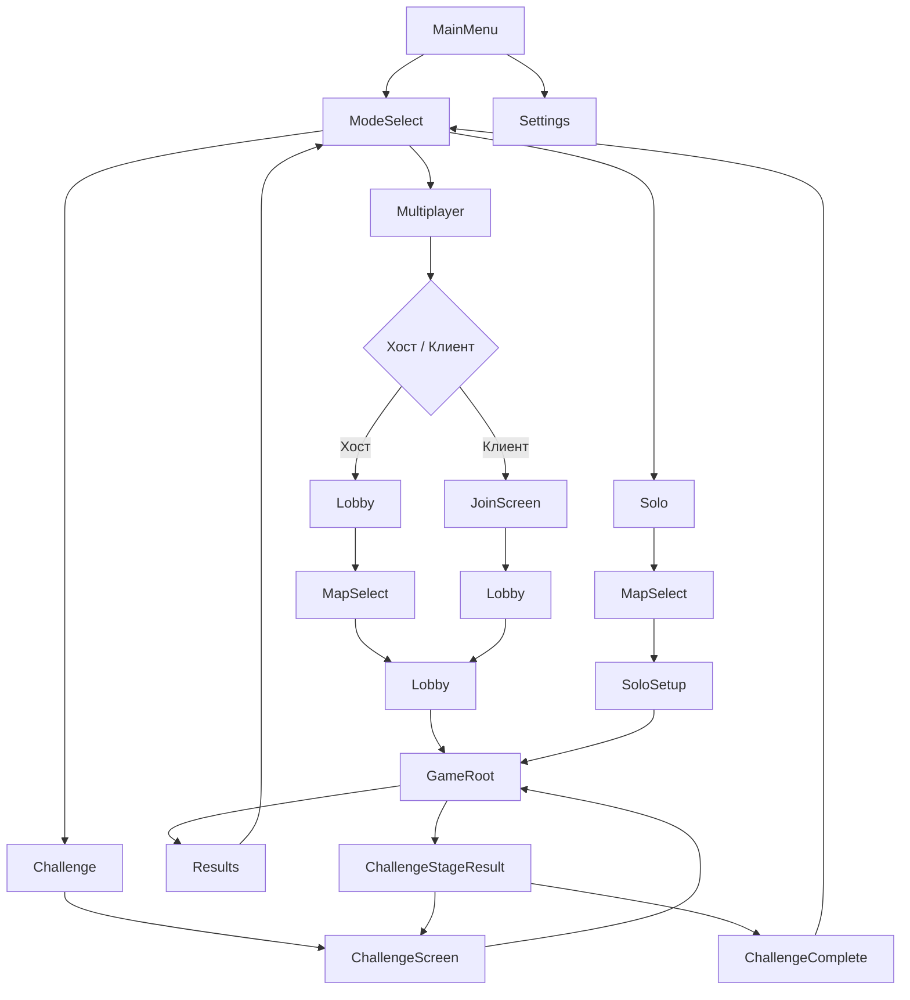

# Техническое задание: перенос «Бумажных подземелий» на Godot 4 (C#)

Документ предназначен для передачи разработчику. Описывает полный объём работ: правила игры, экраны, архитектуру, этапы разработки, сетевой протокол и чеклисты.

**Исходный проект:** WPF-приложение `DungeonPapperWPF` (C# / .NET).  
**Целевой стек:** Godot 4.x, C#, ENet (хост = сервер).  
**Режимы:** соло, мультиплеер (2–4 игрока), челлендж (12 сценариев по порядку).

**Официальные правила:**
- [Правила RU (PDF)](https://media.lavkaigr.ru/uploads/%D0%91%D1%83%D0%BC%D0%B0%D0%B6%D0%BD%D1%8B%D0%B5%20%D0%BF%D0%BE%D0%B4%D0%B7%D0%B5%D0%BC%D0%B5%D0%BB%D1%8C%D1%8F.%20%D0%9F%D1%80%D0%B0%D0%B2%D0%B8%D0%BB%D0%B0.pdf)
- [Rulebook EN (PDF)](https://cdn.1j1ju.com/medias/58/9d/ec-paper-dungeons-a-dungeon-scrawler-game-rulebook.pdf)

---

## Содержание

1. [Краткое описание игры](#1-краткое-описание-игры)
2. [Цели и ограничения](#2-цели-и-ограничения)
3. [Архитектура](#3-архитектура)
4. [Экраны и навигация](#4-экраны-и-навигация)
5. [Структура проекта](#5-структура-проекта)
6. [Модель данных](#6-модель-данных)
7. [Движок правил (RulesEngine)](#7-движок-правил-rulesengine)
8. [Машина состояний партии](#8-машина-состояний-партии)
9. [UI планшета игрока](#9-ui-планшета-игрока)
10. [Режимы игры](#10-режимы-игры)
11. [Сетевая игра](#11-сетевая-игра)
12. [Режим челленджа](#12-режим-челленджа)
13. [Контент](#13-контент)
14. [Этапы разработки](#14-этапы-разработки)
15. [Чеклист соответствия правилам](#15-чеклист-соответствия-правилам)
16. [Справочник уроков Godot](#16-справочник-уроков-godot)
17. [Отличия от текущего WPF-кода](#17-отличия-от-текущего-wpf-кода)

---

## 1. Краткое описание игры

«Бумажные подземелья» (Paper Dungeons) — roll-and-write игра на 1–8 игроков. Каждый игрок управляет командой из 4 героев (воин, маг, священник, плут), исследует общее подземелье, бросает кубики и отмечает прогресс на планшете.

### Ключевые механики

| Механика | Описание |
|----------|----------|
| Партия | 8 раундов, 3 этапа (3+3+2 раунда) |
| Кубики | 6 общих (3 белых + 3 чёрных); переброс при 3+ черепах или 3+ клеверах |
| Раунд | Бросок → урон от черепов → 3 действия → объявление самоцветов |
| Действия | Прокачка героя, крафт артефакта, варка зелий, перемещение |
| Подземелье | Сетка комнат, приспешники, ловушки, сокровища, 8 самоцветов |
| Чудовища | Бои в конце раундов 3, 6, 8 |
| Победа | Больше всего славы (очки за чудовищ, уровни, артефакты, цели, миссии, штрафы) |

### Символы кубиков

| Символ | Цвет | Номер | Назначение |
|--------|------|-------|------------|
| Меч и щит (воин) | белый/чёрный | 1 / 5 | Прокачка воина |
| Шляпа (маг) | белый/чёрный | 2 / 6 | Прокачка мага |
| Крест (священник) | белый/чёрный | 3 / 7 | Прокачка священника |
| Маска (плут) | белый/чёрный | 4 / 8 | Прокачка плута |
| Клевер | только белый | 9 | Универсальный (кроме сапог и черепа) |
| 3 сапога | только чёрный | 0 | 3 перемещения |
| Череп | белый/чёрный | 10 / 11 | 1 ранение всем в начале раунда, кубик не используется |

---

## 2. Цели и ограничения

### Цели

- Реализовать цифровую версию по **официальным правилам**, а не копировать текущий WPF-код.
- Поддержать **соло**, **мультиплеер** (хост = сервер) и **челлендж**.
- Использовать **Godot 4 + C#**.
- Переиспользовать графические ассеты из `Resources/` текущего репозитория.

### Ограничения MVP

| Параметр | MVP | Полная версия |
|----------|-----|---------------|
| Игроков в сети | 2–4 | до 8 |
| Подземелий | 1 (тест) → 12 | 12 |
| Миссии | опционально в соло | всегда в мультиплеере |
| Платформы | Windows, Linux | + macOS, Web (WebRTC) |
| Кампания с переносом прогресса | нет | опционально позже |

### Принципы разработки

1. **RulesEngine** — чистая логика без UI и сети; покрыта unit-тестами.
2. **Сервер авторитативен** — в мультиплеере вся валидация на хосте.
3. **Данные в Resources** — подземелья, чудовища, миссии в `.tres`, не в коде.
4. **Один источник правды** — `GameSession` на сервере, клиенты получают снимки состояния.

---

## 3. Архитектура

### 3.1 Общая схема

```
┌─────────────────────────────────────────────────────────────┐
│                        КЛИЕНТ                                │
│  ┌──────────────┐    ┌──────────────┐    ┌──────────────┐   │
│  │ PlayerSheet  │    │ InputCtrl    │    │ DialogMgr    │   │
│  │ UI           │◄───│              │───►│              │   │
│  └──────────────┘    └──────┬───────┘    └──────────────┘   │
│                             │ RPC (intent)                   │
└─────────────────────────────┼───────────────────────────────┘
                              ▼
┌─────────────────────────────────────────────────────────────┐
│                   ХОСТ / СЕРВЕР                              │
│  ┌──────────────┐    ┌──────────────┐    ┌──────────────┐   │
│  │ NetworkMgr   │───►│ GameState    │───►│ RulesEngine  │   │
│  │              │    │ Machine      │    │              │   │
│  └──────────────┘    └──────────────┘    └──────┬───────┘   │
│                                                  │           │
│                                         ┌────────▼───────┐   │
│                                         │ GameSession    │   │
│                                         │ (состояние)    │   │
│                                         └────────────────┘   │
└─────────────────────────────────────────────────────────────┘
```

### 3.2 Autoload-синглтоны

| Имя | Класс | Назначение |
|-----|-------|------------|
| `GameManager` | `GameManager` | Текущая сессия, контекст запуска |
| `NetworkManager` | `NetworkManager` | ENet, хост/клиент, RPC |
| `SceneRouter` | `SceneRouter` | Переключение сцен, `GameLaunchContext` |
| `ConfigService` | `ConfigService` | Настройки, никнейм, звук |
| `ChallengeController` | `ChallengeController` | Прогресс челленджа (загружается при необходимости) |

### 3.3 Потоки данных

**Соло:** `Input → SoloGameController → RulesEngine → GameSession → UI`

**Мультиплеер:** `Input → RPC → Server RulesEngine → GameSession → RPC snapshot → UI`

---

## 4. Экраны и навигация

### 4.1 Карта экранов



### 4.2 Описание экранов

#### `MainMenu.tscn` — Стартовый экран

| Элемент | Действие |
|---------|----------|
| Логотип | — |
| «Выбрать режим» | → `ModeSelect` |
| «Настройки» | → `Settings` |
| «Выход» | закрыть игру |
| Версия | v1.0.0 |

**Уроки:** [UI introduction (RU)](https://docs.godotengine.org/ru/4.x/getting_started/step_by_step/ui_introduction_to_the_ui_system.html)

---

#### `ModeSelect.tscn` — Выбор режима

| Элемент | Действие |
|---------|----------|
| «Назад» | → `MainMenu` |
| Карточка «Соло» | → `MapSelect` (mode=solo) |
| Карточка «Мультиплеер» | → подменю Хост / Подключиться |
| Карточка «Челлендж» | → `ChallengeScreen` |
| Прогресс челленджа | «3 / 12» (если есть сохранение) |

---

#### `MapSelect.tscn` — Выбор карты подземелья

Показывается для **Соло** и **Мультиплеер (хост)**.

| Элемент | Описание |
|---------|----------|
| Сетка 12 карт | Превью, номер, название |
| Панель деталей | Название, 3 чудовища, сложность ★, описание |
| «Продолжить» | → `SoloSetup` (соло) или обновление лобби (хост) |
| «Назад» | → `ModeSelect` или `Lobby` |

**Поведение:**
- Данные из `resources/dungeons/*.tres`
- В мультиплеере карту выбирает только хост
- Клиенты видят выбранную карту в лобби (read-only)

---

#### `SoloSetup.tscn` — Настройка соло-партии

| Элемент | Описание |
|---------|----------|
| Выбранное подземелье | превью |
| 2 карты цели (случайные) | игрок выбирает 1 |
| 2 карты таланта (случайные) | игрок выбирает 1 |
| Чекбокс «Использовать миссии» | по умолчанию выкл для новичков |
| «Начать игру» | → `GameRoot` |

---

#### `JoinScreen.tscn` — Подключение к игре

| Элемент | Описание |
|---------|----------|
| Поле IP | адрес хоста |
| Поле порта | по умолчанию 7777 |
| Никнейм | из `ConfigService` |
| «Подключиться» | ENet client → `Lobby` |
| Статус | «Подключение...», ошибки |

---

#### `Lobby.tscn` — Лобби мультиплеера

| Элемент | Описание |
|---------|----------|
| Список игроков | ник, статус «Готов» |
| Выбранная карта | превью (хост меняет через `MapSelect`) |
| Кнопка «Выбрать карту» | только хост → `MapSelect` |
| Кнопка «Готов» | каждый игрок |
| Кнопка «Старт» | только хост, когда все готовы и карта выбрана |
| Выбор цели / таланта | 2+2 карты на игрока до старта |

**После старта:** хост инициализирует `GameSession`, рассылает setup, все переходят в `GameRoot`.

---

#### `ChallengeScreen.tscn` — Экран челленджа

| Элемент | Описание |
|---------|----------|
| Название челленджа | «Большое приключение» |
| Прогресс-бар | 7 / 12 |
| Список 12 сценариев | ✓ пройден / → текущий / ○ заблокирован |
| Слава за каждый сценарий | число |
| Суммарная слава | текущая / лучший результат |
| «Продолжить» | старт текущего сценария |
| «Начать заново» | сброс прогресса (с подтверждением) |
| «Назад» | → `ModeSelect` |

---

#### `GameRoot.tscn` — Игровой экран

| Область | Содержимое |
|---------|------------|
| Левая панель | здоровье, ранения, воскрешение |
| Центр | сетка подземелья 6×7 (`DungeonGrid`) |
| Правая панель | герои, артефакты, зелья, самоцветы |
| Низ | кубики, кнопки действий, раунд, слава |
| Оверлеи | диалоги (прокачка, босс, самоцветы, миссии) |

Подробная вёрстка — в [разделе 9](#9-ui-планшета-игрока).

---

#### `Results.tscn` — Итоги партии (соло / мультиплеер)

| Элемент | Описание |
|---------|----------|
| Таблица славы | по категориям (чудовища, уровни, артефакты, штрафы...) |
| Итог | суммарная слава |
| Победитель | в мультиплеере |
| «В меню» | → `ModeSelect` |
| «Сыграть ещё» | → `MapSelect` или `Lobby` |

---

#### `ChallengeStageResult.tscn` — Итог этапа челленджа

| Элемент | Описание |
|---------|----------|
| «Подземелье N пройдено!» | |
| Слава за партию | |
| Суммарная слава челленджа | |
| Следующее подземелье | название |
| «Следующее подземелье» | → `GameRoot` |
| «В меню» | → `ChallengeScreen` |

---

#### `ChallengeComplete.tscn` — Челлендж пройден

| Элемент | Описание |
|---------|----------|
| Поздравление | |
| Итоговая слава за 12 сценариев | |
| Лучший результат | если побит |
| «В меню» | → `ModeSelect` |
| «Начать заново» | сброс челленджа |

---

#### `Settings.tscn` — Настройки

| Элемент | Описание |
|---------|----------|
| Никнейм | |
| Громкость звука / музыки | |
| Язык | RU / EN |
| «Назад» | → `MainMenu` |

---

### 4.3 SceneRouter

```csharp
public partial class SceneRouter : Node
{
    public static SceneRouter Instance { get; private set; }
    public GameLaunchContext LaunchContext { get; private set; } = new();

    public void GoToMainMenu();
    public void GoToModeSelect();
    public void GoToMapSelect(GameMode mode);
    public void GoToSoloSetup(string dungeonId);
    public void GoToLobby(bool isHost);
    public void GoToJoinScreen();
    public void GoToChallengeScreen();
    public void GoToChallengeStageResult(ChallengeProgress progress);
    public void GoToChallengeComplete(ChallengeProgress progress);
    public void StartGame(GameLaunchContext ctx);
    public void GoToResults(GameResults results);
}

public class GameLaunchContext
{
    public GameMode Mode { get; set; }
    public string DungeonId { get; set; } = "";
    public bool IsChallenge { get; set; }
    public ChallengeProgress? ChallengeProgress { get; set; }
    public string? ObjectiveId { get; set; }
    public string? TalentId { get; set; }
    public bool UseMissions { get; set; }
    public List<string> MissionIds { get; set; } = new();
}

public enum GameMode { Solo, Host, Client, Challenge }
```

---

## 5. Структура проекта

```
DungeonPaperGodot/
├── project.godot
├── DungeonPaperGodot.csproj
├── docs/
│   └── GODOT_MIGRATION_SPEC.md          # этот документ
├── scenes/
│   ├── menus/
│   │   ├── MainMenu.tscn
│   │   ├── ModeSelect.tscn
│   │   ├── MapSelect.tscn
│   │   ├── SoloSetup.tscn
│   │   ├── JoinScreen.tscn
│   │   ├── Lobby.tscn
│   │   ├── ChallengeScreen.tscn
│   │   ├── ChallengeStageResult.tscn
│   │   ├── ChallengeComplete.tscn
│   │   ├── Results.tscn
│   │   └── Settings.tscn
│   ├── game/
│   │   ├── GameRoot.tscn
│   │   ├── PlayerSheet.tscn
│   │   ├── DungeonGrid.tscn
│   │   └── RoomCell.tscn
│   └── ui/
│       ├── DicePanel.tscn
│       ├── HeroPanel.tscn
│       ├── BossFightDialog.tscn
│       ├── LevelUpDialog.tscn
│       ├── ArtifactCraftDialog.tscn
│       └── GemAnnounceDialog.tscn
├── scripts/
│   ├── core/
│   │   ├── RulesEngine.cs
│   │   ├── GameStateMachine.cs
│   │   ├── DiceRoller.cs
│   │   ├── ActionResolver.cs
│   │   ├── CombatResolver.cs
│   │   ├── MovementValidator.cs
│   │   ├── DamageResolver.cs
│   │   ├── GemResolver.cs
│   │   ├── GloryCalculator.cs
│   │   └── MissionChecker.cs
│   ├── models/
│   │   ├── GameSession.cs
│   │   ├── PlayerState.cs
│   │   ├── Party.cs
│   │   ├── Hero.cs
│   │   ├── Die.cs
│   │   └── Enums.cs
│   ├── data/
│   │   ├── DungeonData.cs
│   │   ├── BossData.cs
│   │   ├── MissionData.cs
│   │   ├── ObjectiveData.cs
│   │   ├── TalentData.cs
│   │   ├── ArtifactData.cs
│   │   ├── ChallengeConfig.cs
│   │   └── ContentLoader.cs
│   ├── network/
│   │   ├── NetworkManager.cs
│   │   ├── GameRpcHandlers.cs
│   │   └── LobbyState.cs
│   ├── solo/
│   │   ├── SoloGameController.cs
│   │   └── SaveGameService.cs
│   ├── challenge/
│   │   ├── ChallengeController.cs
│   │   └── ChallengeSaveService.cs
│   ├── menus/
│   │   └── (контроллеры экранов)
│   └── ui/
│       └── (контроллеры UI)
├── resources/
│   ├── dungeons/          # 12 × DungeonData.tres
│   ├── bosses/
│   ├── missions/
│   ├── objectives/
│   ├── talents/
│   ├── artifacts/
│   └── challenge/
│       └── main_campaign.tres
├── assets/                # PNG из текущего Resources/
│   ├── heroes/
│   ├── dice/
│   ├── monsters/
│   ├── bosses/
│   ├── ui/
│   └── tiles/
└── tests/
    └── RulesEngineTests/  # unit-тесты
```

---

## 6. Модель данных

### 6.1 Перечисления

```csharp
public enum HeroClassType { Warrior, Wizard, Cleric, Rogue }
public enum Outlook { White, Black }  // тип личности
public enum DieSymbol { Move3, Warrior, Wizard, Cleric, Rogue, Clover, Skull }
public enum DieColor { White, Black }
public enum Barrier { None, Wall, River, Black }
public enum TreasureType { Potion, MagicPart, LevelUp, Gem }
public enum GamePhase { /* см. раздел 8 */ }
public enum GameMode { Solo, Host, Client, Challenge }
```

### 6.2 Resource-классы

```csharp
[GlobalClass]
public partial class DungeonData : Resource
{
    [Export] public string Id { get; set; } = "";
    [Export] public string Name { get; set; } = "";
    [Export] public string Description { get; set; } = "";
    [Export] public int Difficulty { get; set; } = 1;      // 1–5
    [Export] public int OrderIndex { get; set; }             // порядок в челлендже
    [Export] public int Columns { get; set; } = 6;
    [Export] public int Rows { get; set; } = 7;
    [Export] public Godot.Collections.Array<RoomData> Rooms { get; set; } = new();
    [Export] public Vector2I Monster1Room { get; set; }
    [Export] public Vector2I Monster2Room { get; set; }
    [Export] public Vector2I Monster3Room { get; set; }
    [Export] public Godot.Collections.Array<string> BossIds { get; set; } = new(); // 3 id
    [Export] public Texture2D PreviewImage { get; set; }
    [Export] public Texture2D MapBackground { get; set; }
}

[GlobalClass]
public partial class RoomData : Resource
{
    [Export] public Vector2I Coord { get; set; }
    [Export] public Barrier Left { get; set; }
    [Export] public Barrier Right { get; set; }
    [Export] public Barrier Top { get; set; }
    [Export] public Barrier Bottom { get; set; }
    [Export] public bool HasTrap { get; set; }
    [Export] public MinionData? Minion { get; set; }
    [Export] public TreasureData? Treasure { get; set; }
    [Export] public string? GemId { get; set; }  // A–H или null
    [Export] public bool HasTunnel { get; set; }  // ⇄ на краю карты
}

[GlobalClass]
public partial class BossData : Resource
{
    [Export] public string Id { get; set; } = "";
    [Export] public string Name { get; set; } = "";
    [Export] public int Level { get; set; }
    [Export] public HeroClassType Weakness { get; set; }
    [Export] public int RunAwayGloryPenalty { get; set; }
    [Export] public Godot.Collections.Array<BossTierData> Tiers { get; set; } = new();
    [Export] public string? WinnerRewardArtifactPart { get; set; }
    [Export] public Texture2D Image { get; set; }
}

[GlobalClass]
public partial class BossTierData : Resource
{
    [Export] public int MinPower { get; set; }
    [Export] public int Glory { get; set; }
    [Export] public int Wounds { get; set; }
}

[GlobalClass]
public partial class MissionData : Resource
{
    [Export] public string Id { get; set; } = "";
    [Export] public string Description { get; set; } = "";
    [Export] public int GloryReward { get; set; }
    [Export] public string ConditionType { get; set; } = "";  // minions, gems, potions...
    [Export] public int ConditionValue { get; set; }
}

[GlobalClass]
public partial class ObjectiveData : Resource
{
    [Export] public string Id { get; set; } = "";
    [Export] public string Description { get; set; } = "";
    [Export] public int GloryReward { get; set; }
    [Export] public Outlook WarriorStyle { get; set; }
    [Export] public Outlook WizardStyle { get; set; }
    [Export] public Outlook ClericStyle { get; set; }
    [Export] public Outlook RogueStyle { get; set; }
    [Export] public string ConditionType { get; set; } = "";
    [Export] public int ConditionValue { get; set; }
}

[GlobalClass]
public partial class TalentData : Resource
{
    [Export] public string Id { get; set; } = "";
    [Export] public string Description { get; set; } = "";
    [Export] public string Trigger { get; set; } = "";  // setup, condition, per_round, end_game
    [Export] public int GloryBonus { get; set; }
    [Export] public int GloryPenalty { get; set; }
}

[GlobalClass]
public partial class ArtifactData : Resource
{
    [Export] public int Number { get; set; }              // 1–8
    [Export] public string Name { get; set; } = "";
    [Export] public DieSymbol? RequiredSymbol { get; set; } // null = любой
    [Export] public string InstantEffect { get; set; } = "";
    [Export] public string PermanentEffect { get; set; } = "";
    [Export] public int EndGameGloryBonus { get; set; }
}

[GlobalClass]
public partial class ChallengeConfig : Resource
{
    [Export] public string Id { get; set; } = "main_campaign";
    [Export] public string Name { get; set; } = "Большое приключение";
    [Export] public string Description { get; set; } = "";
    [Export] public Godot.Collections.Array<string> DungeonOrder { get; set; } = new(); // 12 id
    [Export] public bool UseFixedMissions { get; set; }
    [Export] public Godot.Collections.Array<string> FixedMissionIds { get; set; } = new();
}

[GlobalClass]
public partial class ChallengeProgress : Resource
{
    [Export] public string ChallengeId { get; set; } = "";
    [Export] public int CurrentIndex { get; set; }
    [Export] public Godot.Collections.Array<int> ScoresPerDungeon { get; set; } = new();
    [Export] public int TotalGlory { get; set; }
    [Export] public int BestTotalGlory { get; set; }
    [Export] public bool IsCompleted { get; set; }
}
```

### 6.3 Runtime-модели (без Godot)

```csharp
public class Hero
{
    public HeroClassType Type { get; set; }
    public int Level { get; set; } = 1;
    public Outlook TrainingStyle { get; set; }
}

public class Party
{
    public Hero Warrior { get; set; }
    public Hero Wizard { get; set; }
    public Hero Cleric { get; set; }
    public Hero Rogue { get; set; }
    public int MaxHealth => Heroes.Sum(h => h.Level);
    public int Wounds { get; set; }
    public bool UsedResurrection { get; set; }
    public List<PotionSlot> Potions { get; set; } = new();
    public List<ArtifactState> Artifacts { get; set; } = new();
    public List<string> CollectedGems { get; set; } = new();
    public int DefeatedMinions { get; set; }
    public int BonusDamageVsBosses { get; set; }
    public int BonusDamageVsMinions { get; set; }
    public IEnumerable<Hero> Heroes => new[] { Warrior, Wizard, Cleric, Rogue };
}

public class PlayerState
{
    public int Id { get; set; }
    public int PeerId { get; set; }
    public string Nickname { get; set; } = "";
    public Party Party { get; set; } = new();
    public List<Vector2I> Path { get; set; } = new();
    public Vector2I? CurrentRoom { get; set; }
    public HashSet<Vector2I> VisitedRooms { get; set; } = new();
    public HashSet<string> UnavailableGems { get; set; } = new();
    public List<string> GemsStolenThisRound { get; set; } = new();
    public int AccumulatedGlory { get; set; }
    public ObjectiveData? Objective { get; set; }
    public TalentData? Talent { get; set; }
    public List<string> CompletedMissions { get; set; } = new();
    public bool ReachedBossRoom1 { get; set; }
    public bool ReachedBossRoom2 { get; set; }
    public bool ReachedBossRoom3 { get; set; }
    public bool IsDisconnected { get; set; }
}

public class GameSession
{
    public string SessionId { get; set; } = Guid.NewGuid().ToString();
    public bool IsSolo { get; set; }
    public bool IsChallenge { get; set; }
    public DungeonData Dungeon { get; set; }
    public List<PlayerState> Players { get; set; } = new();
    public List<MissionData> Missions { get; set; } = new();
    public Die[] DicePool { get; set; } = Array.Empty<Die>();
    public int Round { get; set; }
    public GamePhase Phase { get; set; }
    public int CurrentActionIndex { get; set; }  // 0, 1, 2
}
```

---

## 7. Движок правил (RulesEngine)

Чистая C#-логика без зависимостей от Godot. Покрывается unit-тестами.

### 7.1 Модули

| Модуль | Ответственность |
|--------|-----------------|
| `DiceRoller` | Бросок 6 кубиков, переброс при 3+ черепах/клеверах |
| `ActionResolver` | Прокачка, артефакт, зелья, валидация действий |
| `MovementValidator` | BFS доступных комнат, стены, реки, тоннели, артефакты |
| `CombatResolver` | Бой с приспешниками и чудовищами |
| `DamageResolver` | Ранения, зелья, воскрешение |
| `GemResolver` | Кража, объявление, вычёркивание у соперников |
| `GloryCalculator` | Финальный и промежуточный подсчёт славы |
| `MissionChecker` | Проверка выполнения миссий в конце раунда |

### 7.2 Правила по модулям

#### DiceRoller

```
1. Бросить 3 белых + 3 чёрных кубика
2. Если черепов >= 3 ИЛИ клеверов >= 3 → перебросить все
3. Повторять до выполнения условия
```

#### Прокачка (ActionResolver)

```
Условия:
- Герой < 6 уровня
- Символ кубика = класс героя
- Цвет кубика = тип личности героя
  ИСКЛЮЧЕНИЕ: маг 4+ → любой цвет
- Клевер → любой класс (кроме сапог)

Эффект:
- Уровень героя +1
- Здоровье команды +1 (MaxHealth)
- При 4 уровне → способность класса:
  - Воин: +1 к бою с чудовищами
  - Маг: игнорировать цвет при прокачке
  - Священник: нет урона от черепов
  - Плут: выкрасть самоцвет
```

#### Крафт артефакта

```
- Любой кубик (кроме черепа) → 1 часть артефакта
- Первые 4 артефакта: нужен конкретный символ
- Артефакты 5–8: любой символ
- 2 части = готовый предмет → мгновенный + постоянный эффект
```

#### Зелья

```
- Любой кубик → 2 зелья (макс. 12)
- Каждое зелье = 2 сердца исцеления
- Награды: 4 зелья → level up, 8 → часть артефакта, 12 → самоцвет
```

#### Перемещение

```
- Обычный кубик → 2 шага
- 3 сапога → 3 шага
- Ортогонально, не по диагонали
- Стены: только с артефактом «Кирка» (№4)
- Реки: только с «Сапогами скорохода» (№3)
- Тоннели ⇄ на краях: 1 шаг на противоположный край
- Первый ход: с любого из 6 входов (нижний ряд)

При входе в комнату (порядок!):
1. Бой с приспешником ИЛИ ловушка (+1 ранение)
2. Награда (зелье / артефакт / level up / самоцвет)

Повторный вход:
- События НЕ повторяются (приспешник, награда)
- Ловушка срабатывает СНОВА
```

#### Бой с приспешником

```
- Побеждает герой указанного класса
- Если уровень героя >= уровня приспешника → 0 ранений
- Иначе → ранений = разница уровней
- + бонус от артефакта «Доспехи» (+1 к уровню)
```

#### Бой с чудовищем (раунды 3, 6, 8)

```
Условие участия: команда побывала в комнате чудовища

Боевая мощь =
  сумма уровней всех героев
  + уровень уязвимого героя (удвоение)
  + бонусы (воин 4+, огненный меч +3, и т.д.)

Если мощь < минимума → БЕГСТВО (−N славы, 0 ранений)
Иначе → слава и ранения по tier'у на карте чудовища

В мультиплеере: команда с max мощью → награда с карты
В соло: награды за лучший урон нет
```

#### Самоцветы

```
- 8 на карте (A–H) + 2 вне карты (доступны всем)
- Кража: победить приспешника/ловушку → взять самоцвет
- В конце раунда: объявить украденные буквы
- У всех остальных эти самоцветы вычёркиваются
- Несколько команд могут украсть один самоцвет в одном раунде
```

#### Слава (финал)

```
+ Слава за чудовищ (накопленная)
+ Таблица по минимальному уровню героя
+ +1 за каждого героя 6-го уровня
+ +1 за каждую клетку артефакта + бонусы за готовые
+ Самоцветы, приспешники
+ Цель, талант, миссии
− Штраф за ранения (по таблице на планшете)
− 9 за воскрешение
```

### 7.3 Публичный API RulesEngine

```csharp
public class RulesEngine
{
    // Кубики
    Die[] RollDice();
    void ApplySkullDamage(GameSession session);

    // Валидация
    bool CanPickDie(GameSession session, int playerId, int dieIndex);
    bool CanLevelUp(PlayerState player, Die die, HeroClassType hero);
    bool CanCraftArtifact(PlayerState player, Die die, int artifactNumber);
    bool CanBrewPotions(PlayerState player, Die die);
    bool CanMove(PlayerState player, Die die);
    List<Vector2I> GetReachableRooms(GameSession session, int playerId, int steps);

    // Применение
    void ApplyLevelUp(GameSession session, int playerId, HeroClassType hero);
    void ApplyCraftArtifact(GameSession session, int playerId, int artifactNumber);
    void ApplyBrewPotions(GameSession session, int playerId);
    void ApplyMove(GameSession session, int playerId, Vector2I targetRoom);

    // События комнаты
    void ResolveRoomEntry(GameSession session, int playerId, Vector2I room);

    // Чудовища
    BossFightResult ResolveBossFight(PlayerState player, BossData boss);
    int DetermineBossFightWinner(List<BossFightResult> results);

    // Самоцветы
    void AnnounceGems(GameSession session, int playerId, List<string> gemIds);

    // Миссии
    List<MissionData> CheckMissions(PlayerState player, GameSession session);

    // Финал
    GameResults CalculateFinalResults(GameSession session);
}
```

**Уроки:** [C# в Godot](https://docs.godotengine.org/ru/4.x/tutorials/scripting/c_sharp/index.html), [Unit testing](https://docs.godotengine.org/en/stable/tutorials/scripting/gdscript/gdscript_unit_test.html)

---

## 8. Машина состояний партии

### 8.1 Фазы

```csharp
public enum GamePhase
{
    Setup,
    RoundStart,
    DiceRoll,
    SkullDamage,
    ActionPick1,
    ActionResolve1,
    ActionPick2,
    ActionResolve2,
    ActionPick3,
    ActionResolve3,
    GemAnnounce,
    BossFight,
    RoundEnd,
    GameOver
}
```

### 8.2 Диаграмма переходов

```
SETUP
  → ROUND_START (round++)
  → DICE_ROLL
  → SKULL_DAMAGE
  → ACTION_PICK_1 → ACTION_RESOLVE_1
  → ACTION_PICK_2 → ACTION_RESOLVE_2
  → ACTION_PICK_3 → ACTION_RESOLVE_3
  → GEM_ANNOUNCE
  → [BOSS_FIGHT]  если round ∈ {3, 6, 8}
  → ROUND_END
  → ROUND_START   если round < 8
  → GAME_OVER     если round == 8
```

### 8.3 Ожидание игроков (мультиплеер)

В фазах `ActionPick*`, `ActionResolve*`, `GemAnnounce`, `BossFight` сервер ждёт подтверждения от всех активных игроков (`PhaseWaitTracker`).

---

## 9. UI планшета игрока

### 9.1 Иерархия `PlayerSheet.tscn`

```
PlayerSheet (Control)
├── LeftPanel (VBoxContainer)
│   ├── HealthTrack          # кружки здоровья (сумма уровней)
│   ├── WoundTrack           # ранения (снизу вверх)
│   └── ResurrectionMark
├── HeroPanel (VBoxContainer)
│   ├── WarriorRow           # иконка + 6 чекбоксов уровня + тип личности
│   ├── WizardRow
│   ├── ClericRow
│   └── RogueRow
├── DungeonGrid (GridContainer, columns=6)
│   └── RoomCell × 42
├── RightPanel (VBoxContainer)
│   ├── ArtifactPanel        # 8 предметов × 2 части
│   ├── PotionPanel          # 12 зелий × 2 сердца
│   ├── GemTrack             # 10 кружков
│   └── MinionTrack
├── BottomPanel (HBoxContainer)
│   ├── GloryLabel
│   ├── RoundIndicator       # 1–8, метки чудовищ на 3/6/8
│   └── ActionSlots          # 3 слота выбранных кубиков
└── DicePoolPanel (HBoxContainer)
    └── DieView × 6
```

### 9.2 RoomCell

| Слой | Содержимое |
|------|------------|
| Фон | текстура карты |
| Стены | left/right/top/bottom |
| Иконки | приспешник, ловушка, сокровище, самоцвет |
| Путь | Line2D от предыдущей клетки |
| Подсветка | ColorRect (зелёный/синий/красный) |
| Герои | спрайт party (текущая позиция) |

### 9.3 Диалоги (оверлеи)

| Диалог | Триггер |
|--------|---------|
| `LevelUpDialog` | выбран кубик прокачки |
| `ArtifactCraftDialog` | выбран кубик крафта |
| `BossFightDialog` | фаза BossFight |
| `GemAnnounceDialog` | фаза GemAnnounce (мультиплеер) |
| `MissionCompleteDialog` | конец раунда, миссия выполнена |
| `MessageDialog` | информационные сообщения |

**Уроки:** [Control nodes](https://cursa.app/en/page/ui-hud-and-menus-with-control-nodes-in-godot-4), [GridContainer / chess example](https://medium.com/@hanxuyang0826/introduction-to-godot-chess-development-as-your-first-game-project-bc4d9a8df1c9), [HUD (RU)](https://docs.godotengine.org/ru/4.x/getting_started/first_2d_game/06.heads_up_display.html)

---

## 10. Режимы игры

### 10.1 Соло

```
MainMenu → ModeSelect → MapSelect → SoloSetup → GameRoot → Results
```

- Один `PlayerState`
- `RulesEngine` вызывается локально
- Миссии опциональны
- Нет объявления самоцветов
- Нет награды за лучший урон чудовищу
- Сохранение/загрузка: `user://save_{slot}.tres`

### 10.2 Мультиплеер

```
MainMenu → ModeSelect → Host/Join → Lobby → [MapSelect] → GameRoot → Results
```

- Хост = `ENetMultiplayerPeer.CreateServer()`
- Клиенты = `CreateClient(ip, port)`
- Карту выбирает хост
- Цель и талант — каждый игрок в лобби
- 3 миссии — общие для всех
- Объявление самоцветов обязательно
- Соревнование за урон чудовищам

### 10.3 Челлендж

```
MainMenu → ModeSelect → ChallengeScreen → GameRoot → ChallengeStageResult → ...
```

- 12 подземелий в фиксированном порядке (`ChallengeConfig.DungeonOrder`)
- Каждый сценарий — отдельная партия с нуля (MVP)
- Прогресс в `user://challenge_{id}.tres`
- Прохождение = завершить 8 раундов
- После 12-го → `ChallengeComplete`

---

## 11. Сетевая игра

### 11.1 NetworkManager

```csharp
public partial class NetworkManager : Node
{
    public static NetworkManager Instance { get; private set; }
    private const int DefaultPort = 7777;

    public Error HostGame(int port = DefaultPort, int maxClients = 4);
    public Error JoinGame(string address, int port = DefaultPort);
    public void Disconnect();
    public bool IsServer => Multiplayer.IsServer();
    public int LocalPeerId => Multiplayer.GetUniqueId();
}
```

### 11.2 RPC-протокол

| RPC | Направление | Фаза | Данные |
|-----|-------------|------|--------|
| `RpcSyncPhase` | S→All | любая | phase, round |
| `RpcSyncDicePool` | S→All | DiceRoll | Die[6] |
| `RpcPickDie` | C→S | ActionPick* | dieIndex |
| `RpcSyncDiePicks` | S→All | ActionPick* | playerId, picks[] |
| `RpcSubmitAction` | C→S | ActionResolve* | PlayerAction |
| `RpcActionRejected` | S→C | любая | reason |
| `RpcSyncPlayerState` | S→All | после действия | PlayerStateDto |
| `RpcAnnounceGems` | C→S | GemAnnounce | gemIds[] |
| `RpcSyncUnavailableGems` | S→All | GemAnnounce | per-player gems |
| `RpcBossFightResults` | S→All | BossFight | results[] |
| `RpcSyncMissions` | S→All | RoundEnd | completed missions |
| `RpcGameOver` | S→All | GameOver | GameResults |
| `RpcLobbyUpdate` | S→All | лобби | LobbyState |
| `RpcStartGame` | S→All | лобби | GameLaunchContext |

`S` = сервер (хост), `C` = клиент, `All` = все пиры.

### 11.3 Валидация на сервере

```csharp
[Rpc(MultiplayerApi.RpcMode.AnyPeer)]
private void RpcSubmitAction(PlayerActionDto action)
{
    if (!Multiplayer.IsServer()) return;
    var sender = Multiplayer.GetRemoteSenderId();
    var player = _session.GetPlayerByPeerId(sender);

    if (!_rules.CanPerform(_session, player.Id, action, _phase))
    {
        RpcId(sender, MethodName.RpcActionRejected, "Invalid action");
        return;
    }

    _rules.Apply(_session, player.Id, action);
    Rpc(MethodName.RpcSyncPlayerState, player.ToDto());

    if (_waitTracker.AllReady(_session, _phase))
        _stateMachine.Advance();
}
```

### 11.4 Отключения

| Стратегия | Описание |
|-----------|----------|
| Пауза (MVP) | Ждать 60 сек переподключения |
| Пропуск хода | Авто-pass в фазах выбора |
| Удаление | Хост выгоняет игрока |

**Уроки:** [High-level multiplayer (RU)](https://docs.godotengine.org/ru/4.x/tutorials/networking/high_level_multiplayer.html), [ENetMultiplayerPeer](https://docs.godotengine.org/en/stable/classes/class_enetmultiplayerpeer.html), [Multiplayer tutorial](https://generalistprogrammer.com/tutorials/godot-4-multiplayer-tutorial), [C# signals](https://docs.godotengine.org/en/4.6/tutorials/scripting/c_sharp/c_sharp_signals.html), [Autoload C#](https://www.jetbrains.com/guide/gamedev/tutorials/singletons-autoloads-godot-csharp/)

---

## 12. Режим челленджа

### 12.1 Конфигурация

Файл: `resources/challenge/main_campaign.tres`

```csharp
Id = "main_campaign"
Name = "Большое приключение"
DungeonOrder = [
    "dungeon_01", "dungeon_02", "dungeon_03", "dungeon_04",
    "dungeon_05", "dungeon_06", "dungeon_07", "dungeon_08",
    "dungeon_09", "dungeon_10", "dungeon_11", "dungeon_12"
]
```

### 12.2 ChallengeController

```csharp
public partial class ChallengeController : Node
{
    public ChallengeProgress Progress { get; private set; }
    public ChallengeConfig Config { get; private set; }

    public void LoadOrCreate(string challengeId);
    public void StartCurrentDungeon();     // → GameRoot
    public void OnDungeonCompleted(int glory);
    public void Reset();
    public bool HasActiveProgress { get; }
}
```

### 12.3 Сохранение

Путь: `user://challenge_main_campaign.tres`

Сохраняется после каждого сценария. Сброс — кнопка «Начать заново» с подтверждением.

### 12.4 MVP vs будущее

| | MVP | Позже |
|---|-----|-------|
| Перенос прогресса между сценариями | нет | кампания |
| Условие прохождения | завершить 8 раундов | мин. слава, без воскрешения |
| Несколько челленджей | 1 | разные наборы карт |
| Таблица лидеров | нет | онлайн |

---

## 13. Контент

### 13.1 Объём

| Тип | Количество | Формат |
|-----|------------|--------|
| Подземелья | 12 | `DungeonData.tres` |
| Чудовища | 12 | `BossData.tres` |
| Миссии | 16 | `MissionData.tres` |
| Цели | 16 | `ObjectiveData.tres` |
| Таланты | 16 | `TalentData.tres` |
| Артефакты | 8 | `ArtifactData.tres` (фиксированы) |
| Кубики | 12 граней | текстуры `dice_0..11.png` |
| Герои | 4 × 5 уровней | `Warrior.png`, `Warrior_3.png`... |
| Приспешники | 4 типа | Goblin, Ork, Skelet, Prizrak |
| UI | — | из `Resources/` текущего репозитория |

### 13.2 Артефакты

| № | Название | Мгновенный эффект | Постоянный |
|---|----------|-------------------|------------|
| 1 | Огненный меч | — | +3 к бою с чудовищами |
| 2 | Посох некроманта | убить 2 приспешников | — |
| 3 | Сапоги скорохода | — | переход через реки |
| 4 | Кирка | — | проход сквозь стены |
| 5 | Доспехи | — | +1 к бою с приспешниками |
| 6 | Котёл алхимика | 3 зелья | — |
| 7 | Амулет силы | — | +1 к бою с приспешниками |
| 8 | Корона | повышение уровня | — |

### 13.3 Локализация

- Основной язык: RU
- Дополнительно: EN
- Файлы: `resources/localization/ru.po`, `en.po`
- Использование: `Tr("KEY")` в C#

**Уроки:** [Интернационализация (RU)](https://docs.godotengine.org/ru/4.x/tutorials/i18n/internationalizing_games.html), [Custom Resources](https://ezcha.net/news/3-1-23-custom-resources-are-op-in-godot-4)

---

## 14. Этапы разработки

### Этап 0. Подготовка (1–2 дня)

**Результат:** спецификация правил, структура проекта.

| # | Задача |
|---|--------|
| 0.1 | Создать Godot 4 .NET проект |
| 0.2 | Настроить `.csproj`, папки, autoload |
| 0.3 | Импортировать ассеты из `Resources/` |
| 0.4 | Зафиксировать правила в `docs/rules-spec.md` (выжимка из PDF) |

**Уроки:** [Введение (RU)](https://docs.godotengine.org/ru/4.x/about/introduction.html), [Шаг за шагом (RU)](https://docs.godotengine.org/ru/4.x/getting_started/step_by_step/index.html), [C# (RU)](https://docs.godotengine.org/ru/4.x/tutorials/scripting/c_sharp/index.html)

**Критерий:** проект открывается, ассеты видны в FileSystem.

---

### Этап 1. Меню и навигация (3–5 дней)

**Результат:** все экраны меню с навигацией (без игровой логики).

| # | Задача | Экран |
|---|--------|-------|
| 1.1 | `SceneRouter`, `GameLaunchContext` | — |
| 1.2 | Стартовый экран | `MainMenu` |
| 1.3 | Выбор режима | `ModeSelect` |
| 1.4 | Выбор карты (заглушка 1 карта) | `MapSelect` |
| 1.5 | Настройка соло | `SoloSetup` |
| 1.6 | Настройки | `Settings` |
| 1.7 | Экран челленджа (UI) | `ChallengeScreen` |
| 1.8 | Лобби (UI без сети) | `Lobby` |
| 1.9 | Подключение (UI) | `JoinScreen` |

**Уроки:** [UI introduction (RU)](https://docs.godotengine.org/ru/4.x/getting_started/step_by_step/ui_introduction_to_the_ui_system.html), [Control nodes](https://cursa.app/en/page/ui-hud-and-menus-with-control-nodes-in-godot-4), [UI Tutorial](https://blog.febucci.com/2024/11/godots-ui-tutorial-part-one/)

**Критерий:** можно пройти по всем экранам: Меню → Режим → Карта → Настройка → (заглушка игры).

---

### Этап 2. Данные и контент (3–5 дней)

**Результат:** Resource-классы, 1 полное подземелье, все артефакты.

| # | Задача |
|---|--------|
| 2.1 | Resource-классы: Dungeon, Room, Boss, Mission, Objective, Talent, Artifact |
| 2.2 | `ContentLoader` |
| 2.3 | Создать 1 подземелье в редакторе (`.tres`) |
| 2.4 | 3 чудовища для этого подземелья |
| 2.5 | 8 артефактов |
| 2.6 | `ChallengeConfig` + `ChallengeProgress` |
| 2.7 | Подключить `MapSelect` к реальным данным |

**Уроки:** [Resources (RU)](https://docs.godotengine.org/ru/4.x/tutorials/scripting/resources.html), [C# exports](https://docs.godotengine.org/en/stable/tutorials/scripting/c_sharp/c_sharp_exports.html)

**Критерий:** `MapSelect` показывает карту с превью, чудовищами, сложностью.

---

### Этап 3. Движок правил (7–10 дней)

**Результат:** `RulesEngine` с unit-тестами.

| # | Задача | Модуль |
|---|--------|--------|
| 3.1 | Модели: Hero, Party, PlayerState, GameSession | models |
| 3.2 | Бросок кубиков, переброс | DiceRoller |
| 3.3 | Урон от черепов | DamageResolver |
| 3.4 | Прокачка, артефакты, зелья | ActionResolver |
| 3.5 | Перемещение, BFS, стены, реки, тоннели | MovementValidator |
| 3.6 | Приспешники, ловушки | CombatResolver |
| 3.7 | Чудовища, боевая мощь, tier'ы | CombatResolver |
| 3.8 | Самоцветы, объявление | GemResolver |
| 3.9 | Миссии | MissionChecker |
| 3.10 | Подсчёт славы | GloryCalculator |
| 3.11 | Unit-тесты (минимум 20 сценариев) | tests |

**Критерий:** все тесты зелёные; можно симулировать партию в консоли.

---

### Этап 4. Машина состояний (2–3 дня)

**Результат:** `GameStateMachine` управляет фазами.

| # | Задача |
|---|--------|
| 4.1 | `GamePhase` enum, переходы |
| 4.2 | `GameStateMachine` с сигналами |
| 4.3 | `PhaseWaitTracker` для мультиплеера |
| 4.4 | Интеграция с `RulesEngine` |

**Уроки:** [Signals C#](https://docs.godotengine.org/en/4.6/tutorials/scripting/c_sharp/c_sharp_signals.html), [State Machine](https://godotfoundry.com/blog/godot-4-state-machine-tutorial)

**Критерий:** state machine проходит все фазы для 1 игрока programmatically.

---

### Этап 5. UI планшета и игровой экран (7–10 дней)

**Результат:** визуальный планшет, можно играть соло.

| # | Задача |
|---|--------|
| 5.1 | `RoomCell`, `DungeonGrid` (6×7) |
| 5.2 | Отрисовка стен, иконок, пути |
| 5.3 | Подсветка доступных ходов |
| 5.4 | Панели: герои, здоровье, зелья, артефакты, самоцветы |
| 5.5 | Панель кубиков, выбор, кнопки действий |
| 5.6 | Диалоги: прокачка, крафт, босс |
| 5.7 | `SoloGameController` — связка UI ↔ RulesEngine |
| 5.8 | `GameRoot` — сборка экрана |
| 5.9 | `Results` — итоги партии |

**Критерий:** можно пройти полную соло-партию (8 раундов) на 1 подземелье.

---

### Этап 6. Соло-режим полностью (3–5 дней)

**Результат:** соло с выбором карты, цели, таланта.

| # | Задача |
|---|--------|
| 6.1 | `SoloSetup` — выбор цели и таланта |
| 6.2 | Опциональные миссии |
| 6.3 | Сохранение/загрузка партии |
| 6.4 | Полный flow: Меню → Соло → Карта → Настройка → Игра → Результаты |

**Уроки:** [Saving games (RU)](https://docs.godotengine.org/ru/4.x/tutorials/io/saving_games.html)

**Критерий:** полный цикл соло работает end-to-end.

---

### Этап 7. Режим челленджа (3–5 дней)

**Результат:** 12 сценариев по порядку с сохранением прогресса.

| # | Задача |
|---|--------|
| 7.1 | `ChallengeController`, `ChallengeSaveService` |
| 7.2 | `ChallengeScreen` — список, прогресс |
| 7.3 | `ChallengeStageResult`, `ChallengeComplete` |
| 7.4 | Интеграция: после партии → результат → следующий / меню |
| 7.5 | Сброс прогресса |

**Критерий:** можно пройти 2+ сценария подряд, прогресс сохраняется.

---

### Этап 8. Сетевая игра (7–10 дней)

**Результат:** 2–4 игрока, хост = сервер.

| # | Задача |
|---|--------|
| 8.1 | `NetworkManager` — host/join |
| 8.2 | `Lobby` — список игроков, готовность |
| 8.3 | Выбор карты хостом, синхронизация |
| 8.4 | RPC-протокол (все методы из раздела 11) |
| 8.5 | Серверная валидация действий |
| 8.6 | Синхронизация кубиков, состояний игроков |
| 8.7 | Объявление самоцветов |
| 8.8 | Бой с чудовищами, определение победителя |
| 8.9 | Обработка отключений |
| 8.10 | `Results` для мультиплеера |

**Уроки:** [High-level multiplayer (RU)](https://docs.godotengine.org/ru/4.x/tutorials/networking/high_level_multiplayer.html), [Multiplayer tutorial](https://generalistprogrammer.com/tutorials/godot-4-multiplayer-tutorial)

**Критерий:** 2 игрока по LAN проходят полную партию.

---

### Этап 9. Полный контент (5–7 дней)

**Результат:** все 12 подземелий, карты, миссии, цели, таланты.

| # | Задача |
|---|--------|
| 9.1 | 12 подземелий |
| 9.2 | 12 чудовищ |
| 9.3 | 16 миссий, 16 целей, 16 талантов |
| 9.4 | Локализация RU + EN |

**Критерий:** любое подземелье выбирается и корректно загружается.

---

### Этап 10. Полировка и релиз (5–7 дней)

**Результат:** релизный билд.

| # | Задача |
|---|--------|
| 10.1 | Звуки: бросок, урон, победа, босс |
| 10.2 | Анимации UI (tween подсветки, кубики) |
| 10.3 | Туториал / справка |
| 10.4 | Экспорт Windows + Linux |
| 10.5 | Финальное тестирование по чеклисту |

**Уроки:** [Экспорт (RU)](https://docs.godotengine.org/ru/4.x/tutorials/export/index.html), [Аудио (RU)](https://docs.godotengine.org/ru/4.x/tutorials/audio/index.html)

**Критерий:** билд запускается, все режимы работают.

---

### Сводная таблица вех

| Веха | Этапы | Что можно проверить |
|------|-------|---------------------|
| M1 | 0–1 | Навигация по всем экранам |
| M2 | 2–3 | RulesEngine + тесты |
| M3 | 4–5 | Соло-партия на 1 карте |
| M4 | 6 | Полный соло flow |
| M5 | 7 | Челлендж 2+ сценария |
| M6 | 8 | Мультиплеер 2 игрока |
| M7 | 9–10 | Релиз |

---

## 15. Чеклист соответствия правилам

### Подготовка
- [ ] Выбор подземелья (карта)
- [ ] 3 чудовища по карте подземелья
- [ ] 3 миссии (опционально в соло)
- [ ] 1 цель + 1 талант на игрока
- [ ] Тип личности героев с карты цели

### Раунд
- [ ] 8 раундов, 3 этапа (3+3+2)
- [ ] 6 общих кубиков (3 белых + 3 чёрных)
- [ ] Переброс при 3+ черепах или 3+ клеверах
- [ ] Урон от черепов в начале раунда
- [ ] 3 действия за раунд
- [ ] Кубики общие (несколько игроков могут взять один)

### Герои
- [ ] 4 класса, уровни 1–6
- [ ] Прокачка: символ + цвет (маг 4+ — любой цвет)
- [ ] Способности на 4-м уровне (воин, маг, священник, плут)
- [ ] Здоровье = сумма уровней

### Действия
- [ ] 8 артефактов, 2 части каждый
- [ ] 12 зелий, награды за 4/8/12
- [ ] Движение: 2 шага (3 сапога)
- [ ] Ортогональное движение, тоннели на краях

### Подземелье
- [ ] 4 типа приспешников, уровни 3–5
- [ ] Ловушки (повторно при повторном входе)
- [ ] Порядок событий: бой/ловушка → награда
- [ ] 8 самоцветов + 2 вне карты
- [ ] Объявление самоцветов (мультиплеер)

### Чудовища
- [ ] Бои в раундах 3, 6, 8
- [ ] Боевая мощь с удвоением уязвимого героя
- [ ] Бегство при недостаточной мощи
- [ ] Награда лидеру (мультиплеер)
- [ ] Нет награды лидеру (соло)

### Слава
- [ ] Промежуточная (чудовища, миссии)
- [ ] Финальная (уровни, артефакты, самоцветы, штрафы)
- [ ] Воскрешение (−9)
- [ ] Штраф за ранения

### Режимы
- [ ] Соло: выбор карты → цель/талант → игра
- [ ] Мультиплеер: хост, лобби, выбор карты хостом
- [ ] Челлендж: 12 сценариев по порядку, сохранение прогресса

### Экраны
- [ ] MainMenu → ModeSelect → ...
- [ ] MapSelect для соло и хоста
- [ ] ChallengeScreen с прогрессом

---

## 16. Справочник уроков Godot

### Начало работы
| Тема | Ссылка |
|------|--------|
| Введение (RU) | https://docs.godotengine.org/ru/4.x/about/introduction.html |
| Шаг за шагом (RU) | https://docs.godotengine.org/ru/4.x/getting_started/step_by_step/index.html |
| Первая 2D игра (RU) | https://docs.godotengine.org/ru/4.x/getting_started/first_2d_game/index.html |
| C# в Godot (RU) | https://docs.godotengine.org/ru/4.x/tutorials/scripting/c_sharp/index.html |

### UI
| Тема | Ссылка |
|------|--------|
| UI introduction (RU) | https://docs.godotengine.org/ru/4.x/getting_started/step_by_step/ui_introduction_to_the_ui_system.html |
| Control nodes | https://cursa.app/en/page/ui-hud-and-menus-with-control-nodes-in-godot-4 |
| UI Tutorial Part 1 | https://blog.febucci.com/2024/11/godots-ui-tutorial-part-one/ |
| GridContainer (шахматы) | https://medium.com/@hanxuyang0826/introduction-to-godot-chess-development-as-your-first-game-project-bc4d9a8df1c9 |
| HUD (RU) | https://docs.godotengine.org/ru/4.x/getting_started/first_2d_game/06.heads_up_display.html |

### Архитектура
| Тема | Ссылка |
|------|--------|
| Singletons / Autoload (RU) | https://docs.godotengine.org/ru/4.x/tutorials/scripting/singletons_autoload.html |
| Autoload в C# | https://www.jetbrains.com/guide/gamedev/tutorials/singletons-autoloads-godot-csharp/ |
| Signals (RU) | https://docs.godotengine.org/ru/4.x/getting_started/step_by_step/signals.html |
| Signals C# | https://docs.godotengine.org/en/4.6/tutorials/scripting/c_sharp/c_sharp_signals.html |
| State Machine | https://godotfoundry.com/blog/godot-4-state-machine-tutorial |
| Resources (RU) | https://docs.godotengine.org/ru/4.x/tutorials/scripting/resources.html |
| Custom Resources | https://ezcha.net/news/3-1-23-custom-resources-are-op-in-godot-4 |
| C# exports | https://docs.godotengine.org/en/stable/tutorials/scripting/c_sharp/c_sharp_exports.html |

### Сеть
| Тема | Ссылка |
|------|--------|
| High-level multiplayer (RU) | https://docs.godotengine.org/ru/4.x/tutorials/networking/high_level_multiplayer.html |
| ENetMultiplayerPeer | https://docs.godotengine.org/en/stable/classes/class_enetmultiplayerpeer.html |
| Multiplayer tutorial | https://generalistprogrammer.com/tutorials/godot-4-multiplayer-tutorial |
| ENet guide | https://gtstu.com/2026/06/15/godot-4-multiplayer-tutorial-beginners/ |

### Данные и экспорт
| Тема | Ссылка |
|------|--------|
| Saving games (RU) | https://docs.godotengine.org/ru/4.x/tutorials/io/saving_games.html |
| Интернационализация (RU) | https://docs.godotengine.org/ru/4.x/tutorials/i18n/internationalizing_games.html |
| Экспорт (RU) | https://docs.godotengine.org/ru/4.x/tutorials/export/index.html |
| Аудио (RU) | https://docs.godotengine.org/ru/4.x/tutorials/audio/index.html |

### Правила игры
| Тема | Ссылка |
|------|--------|
| Правила RU (PDF) | https://media.lavkaigr.ru/uploads/%D0%91%D1%83%D0%BC%D0%B0%D0%B6%D0%BD%D1%8B%D0%B5%20%D0%BF%D0%BE%D0%B4%D0%B7%D0%B5%D0%BC%D0%B5%D0%BB%D1%8C%D1%8F.%20%D0%9F%D1%80%D0%B0%D0%B2%D0%B8%D0%BB%D0%B0.pdf |
| Rulebook EN (PDF) | https://cdn.1j1ju.com/medias/58/9d/ec-paper-dungeons-a-dungeon-scrawler-game-rulebook.pdf |
| Обзор правил (EN) | https://whatsericplaying.com/2022/07/04/paper-dungeons/ |

---

## 17. Отличия от текущего WPF-кода

Текущий `DungeonPapperWPF` — упрощённый прототип. При реализации по правилам **не копировать** его логику, а добавить:

| Функция | WPF | По правилам |
|---------|-----|-------------|
| Карты целей | нет | 16 карт, тип личности героев |
| Карты талантов | нет (AbbilityUtil частично) | 16 карт |
| Миссии | частично | 16 карт, гонка |
| Объявление самоцветов | нет | обязательно в мультиплеере |
| Тоннели на краях | частично (rows 3, 5) | по карте подземелья |
| Общие кубики | нет (одиночные) | 6 общих на всех |
| Полный подсчёт славы | частично | все категории + штрафы |
| Соревновательные боссы | упрощённо | сравнение урона между игроками |
| Челлендж | нет | 12 сценариев по порядку |
| Меню режимов | упрощённо | ModeSelect → MapSelect |

### Что можно переиспользовать из WPF

- PNG-ассеты из `Resources/`
- Идеи расположения UI (планшет: герои слева, карта центр, инвентарь справа)
- Данные подземелий из `code/Quests.cs` как основа для `DungeonData.tres` (сверить с rulebook)

---

## Приложение A. Карта экранов (краткая)

| # | Сцена | Файл | Предок |
|---|-------|------|--------|
| 1 | Стартовый экран | `MainMenu.tscn` | — |
| 2 | Выбор режима | `ModeSelect.tscn` | MainMenu |
| 3 | Выбор карты | `MapSelect.tscn` | ModeSelect |
| 4 | Настройка соло | `SoloSetup.tscn` | MapSelect |
| 5 | Подключение | `JoinScreen.tscn` | ModeSelect |
| 6 | Лобби | `Lobby.tscn` | JoinScreen / ModeSelect |
| 7 | Челлендж | `ChallengeScreen.tscn` | ModeSelect |
| 8 | Игра | `GameRoot.tscn` | SoloSetup / Lobby / Challenge |
| 9 | Результаты | `Results.tscn` | GameRoot |
| 10 | Итог этапа челленджа | `ChallengeStageResult.tscn` | GameRoot |
| 11 | Челлендж пройден | `ChallengeComplete.tscn` | ChallengeStageResult |
| 12 | Настройки | `Settings.tscn` | MainMenu |

---

## Приложение B. Порядок челленджа (MVP)

| № | ID | Название (заполнить) |
|---|-----|----------------------|
| 1 | dungeon_01 | — |
| 2 | dungeon_02 | — |
| 3 | dungeon_03 | — |
| 4 | dungeon_04 | — |
| 5 | dungeon_05 | — |
| 6 | dungeon_06 | — |
| 7 | dungeon_07 | — |
| 8 | dungeon_08 | — |
| 9 | dungeon_09 | — |
| 10 | dungeon_10 | — |
| 11 | dungeon_11 | — |
| 12 | dungeon_12 | — |

Порядок и названия уточнить по картам из коробки / `code/Quests.cs`.

---

*Документ подготовлен для передачи разработчику. Версия 1.0.*
